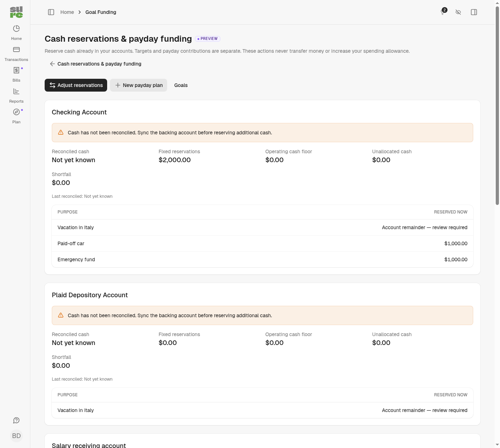
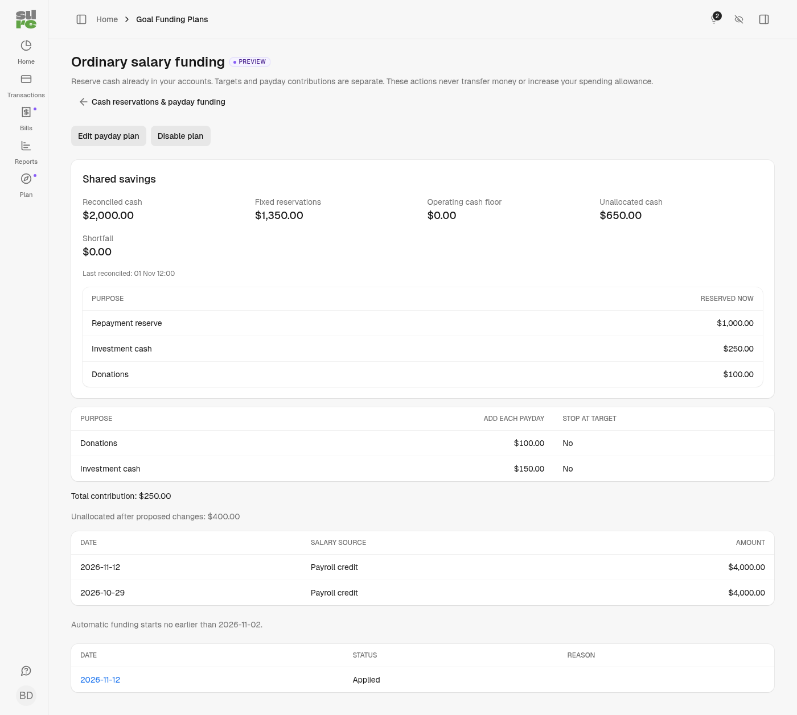

# Cash reservations and payday funding

This preview feature reserves cash inside existing savings accounts. It does not
transfer money, trade securities, create financial entries, or change budget
allowances. The implementation branch starts at upstream commit
`66bed16ba1c5396d3aa238d4171302c8b35d0e94`.

Existing goals already support fixed earmarks and account remainder claims.
Paused goals keep their reservations; completed and archived goals release them.
Goal pledges continue recognizing real transfers or balance increases, and budget
rollover remains separate. No allocations are changed or historical salaries
backfilled by the migration.

## Set up through Plan → Cash reservations & payday funding

Enable preview features in Preferences. Create maintained goals using Goals and
link their backing savings account. Opening amounts are choices the user makes;
there are no default emergency, donation or investment balances.

The reservation overview shows reconciled cash, requested fixed reservations,
operating cash floor, unallocated cash and shortfall. Requested reservations are
protected even if the existing goals display scales effective backing down.
Paused reservations also count. Other users' private purposes are unnamed but
still protect their share of the cash.

Use **Adjust reservations** to set an exact amount, add cash, release cash, move
cash between two purposes in the same account, or set the operating floor. Every
operation has a reason and before/after preview. Apply uses the preview's account
version and request key; stale edits require a new preview. Replaying an identical
request returns its original result; changing its payload requires a new key.

An account remainder claim must be explicitly converted to an exact reservation
with a signed preview and confirmation. Once an account participates in a payday
plan, its old goal form cannot overwrite earmarks. Use reservation controls;
new goals may link it with an explicit zero opening amount. Target-only edits
remain available in the normal goal form.

Examples: release the investment reserve after a genuine broker transfer; move
80 from a donation purpose to a card-repayment purpose after a card donation;
release that repayment reservation after the genuine card payment. The real bank
transactions retain their own transfer/category classifications. These allocation
changes do not create substitute transactions.

## Configure a payday plan

Choose a real confirmed ordinary-salary sample, the backing savings account,
exact payroll description, salary amount range, optional literal notes marker,
effective start date, and fixed positive contribution rules. The source salary
account can differ from the backing account. All accounts and goals in the plan
must use the same currency. The plan owner needs visibility of the source and
full control of the backing account and every account linked to a rule's goal.

Description matching reuses the existing rule engine's exact name comparison,
including whitespace normalization and provider description handling. It does
not match an employer substring. Review the shown historical matches and verify
that the descriptor, notes and amount range exclude equity proceeds and bonuses.
Each eligible matching transaction is one payday; overlapping plans each have
independent contributions and share the same cash protection checks.

Save a disabled draft, inspect the matches and full cash preview, then explicitly
confirm and enable. Maintained reserves continue above their target unless
**Stop at target** is selected. A capped rule adds only its remaining gap; an
all-zero gap records an applied no-op.

Entries have dates, without a universal trustworthy bank posting timestamp.
Automation therefore starts at the later of the configured effective date and
the next family-local day after enabling. Same-day salaries are conservatively
excluded, along with earlier historical imports and future-dated transactions.
Re-enabling establishes a new boundary. These restrictions are intentional;
there is no inferred calendar payday or automatic historical backfill.

## Cash and processing guarantees

A successful account sync checkpoints its cash after reconciliation commits.
Existing accounts need a successful sync before new commitments can be funded.
Entry changes invalidate that checkpoint in the same transaction. Available cash
uses the lower of the checkpoint and current cached balance, less all requested
fixed commitments and the operating floor, counted once. This is a conservative
cash check, not a prediction of future income or bills. The floor and recorded
reserves protect known commitments; the application does not discover every bill.

Pending backing-account transactions or incomplete reconciliation require review
rather than an optimistic available-cash estimate. Pending holds are not also
subtracted from a provider balance whose hold treatment is unknown. Releases and
net-neutral reallocations remain available while cash is uncertain. A cash drop
can produce a visible shortfall without silently reducing saved reservations.

The source account must also have completed reconciliation; recovery cannot
act on a newly imported entry before its source account has reconciled.
Only confirmed, standard, unsplit inflows on the configured source account can
trigger funding. Excluded entries, transfers and pending/future entries cannot.
The source uses the canonical Entry ID already maintained by provider importers;
a pending-to-posted update cannot create a second applied run for that identity.

Runs lock the plan, run, affected accounts and goal projections. Account advisory
locks use the same ordered namespace as existing whole-account claim checks.
Unique database indexes enforce one run per plan/source, one funding batch per
run, and one request key per family. Reservation projection, audit deltas and
applied state commit together. A failed allocation is rolled back before marking
failure, so an applied result is never mistaken for an unapplied failure.

A 250 contribution with only 200 available applies nothing and waits for funds.
Successful reconciliation or reservation release queues another evaluation;
15-minute bounded recovery catches missed enqueues. A newer payday sends older
unresolved runs to review, preventing a silent backlog. Configuration changes
disable the plan and preserve waiting snapshots. Retrying uses a newly signed
preview and records the prior snapshot, revision, actor and review timestamp.

An applied source changed or deleted later is flagged for review, including when
its plan is disabled. No automatic clawback occurs. A compensating reversal
requires a fresh preview and enough cash still reserved for every original
contribution. If later usage consumed that reserve, correction requires manual
review. Disabling preserves all reservations and audit history.

## API and MCP

API endpoints require preview access and the existing API-key or OAuth scopes:

- `GET/POST /api/v1/goals`, `GET/PATCH/DELETE /api/v1/goals/:id`.
  Writes accept goal fields plus explicit account allocations. Updates/deletes
  require the goal `version`; allocation writes additionally require account
  `versions`, `idempotency_key` and `reason`.
- `POST /api/v1/goal_allocations/preview` and `POST /api/v1/goal_allocations`.
  Pass `allocation: { adjustments: [{ goal_id, account_id, mode, amount }],
  versions: { account_id: version }, idempotency_key, reason }`. Amounts are exact
  decimal strings, with at most four fractional digits. A move is a release and
  add in the same request. `floors` maps account IDs to exact operating floors.
- `GET/POST /api/v1/goal_funding_plans`, `GET/PATCH /api/v1/goal_funding_plans/:id`;
  `GET .../:id/preview`, `POST .../:id/enable`, `POST .../:id/disable`.
  Plan updates require `revision`; enabling requires `preview_token` and
  `confirm_salary_source: true`.
- `GET /api/v1/goal_funding_plans/:id/goal_funding_runs`,
  `GET /api/v1/goal_funding_runs/:id`, `GET .../:id/preview`,
  `POST .../:id/retry`, `POST .../:id/skip`, `POST .../:id/reverse`.
  Use `operation=reverse` for a reversal preview. Retry/reverse use its token.

Collections are bounded to 100 records (latest runs and recent 20 source matches).
The generated OpenAPI describes request/response schemas. Errors include stable
codes; stale versions, previews and idempotency mismatches return conflict (409).
Unauthorized/private records return 404 without their financial details. Guest
writes and read-scoped credential writes are refused.

The normal assistant/MCP registry includes `get_goals`, `update_goal`,
`adjust_goal_allocations`, `get_goal_funding_plans`, `get_goal_funding_runs`,
`create_goal_funding_plan`, `update_goal_funding_plan`,
`preview_goal_funding_plan`, `enable_goal_funding_plan`,
`disable_goal_funding_plan` and `review_goal_funding_run` for preview users.
Reservation adjustment previews by default; `apply: true` is explicit.
`create_goal` retains its existing one-off default and adds maintained goals
with explicit opening allocations, versions, reason and key. MCP uses its own
existing read-write OAuth authorization; API keys apply to `/api/v1`, not MCP.

All new UI strings use locale keys with English fallback. Financial matching
uses stored transaction descriptions and exact decimal values, independent of
the translated labels. Display formatting follows application locale and money
currency. Translated salary descriptions are never used as matching rules.

## Rollout and rollback

Apply the additive Rails migration through the normal release process, then
complete a normal sync for backing accounts. There is no historical funding job
or default plan. Automation only processes plans their owner explicitly enabled.
Stopping the new recovery schedule and disabling plans stops new execution while
keeping projections and audit data readable. Do not drop history tables to turn
the feature off. Deployments must keep the schema while any running code refers
to these fields.

Bank transfers, investment orders, percentage splits, automatic donation/card
attribution, partial priority funding, multi-currency plans and calendar/holiday
payday rules remain outside this release.

## Screenshots

Synthetic browser-test data, with no personal account records:

